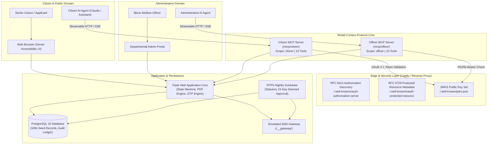

<div align="center">

# 🏛️ SewaSetu AI
### Autonomous Agentic Public Welfare & Pension Infrastructure

[](https://www.python.org/)
[](https://flask.palletsprojects.com/)
[](https://www.postgresql.org/)
[](https://modelcontextprotocol.io/)
[](https://datatracker.ietf.org/doc/rfc9728/)
[](https://www.docker.com/)
[](LICENSE)

<p align="center">
  <b>A production-grade GovTech platform re-imagining public welfare delivery for the agentic era.</b><br>
  Engineered with strict dual-endpoint Model Context Protocol (MCP) servers, RFC 9728 discovery metadata, RS256 token verification, senior citizen accessibility, and live database invariant evaluations.
</p>

<p align="center">
  <b>Architected &amp; Developed by <a href="https://github.com/12636373">Harish</a></b>
</p>

---

</div>

## 📑 Table of Contents

- [Overview](#-overview)
- [System Architecture](#-system-architecture)
- [Key Innovations & Technical Pillars](#-key-innovations--technical-pillars)
  - [1. Physical MCP Separation](#1-physical-mcp-separation)
  - [2. Enterprise OAuth 2.1 & RFC 9728 Discovery](#2-enterprise-oauth-21--rfc-9728-discovery)
  - [3. Persona-Driven PostgreSQL Invariant Evaluations](#3-persona-driven-postgresql-invariant-evaluations)
  - [4. Senior-First Accessible Web Portal](#4-senior-first-accessible-web-portal)
  - [5. Statutory SLA & RTPS Deemed Approval Engine](#5-statutory-sla--rtps-deemed-approval-engine)
- [Interactive Endpoints Directory](#-interactive-endpoints-directory)
- [MCP Toolsets Reference](#-mcp-toolsets-reference)
- [Quick Start & Local Setup](#-quick-start--local-setup)
- [Connecting Agent Clients (Claude Code, Cursor, Windsurf)](#-connecting-agent-clients)
- [Test Suites & Quality Verification](#-test-suites--quality-verification)
- [Directory Structure](#-directory-structure)
- [Security & Prompt Injection Defenses](#-security--prompt-injection-defenses)
- [Author & License](#-author--license)

---

## 💡 Overview

Public distribution systems and state welfare pensions often present severe hurdles for the vulnerable and elderly: opaque application queues, complex documentation requirements, and inflexible bureaucratic portals.

**SewaSetu AI** solves this by establishing an **agent-ready civic bridge**:
1. **Citizens** interact seamlessly with an AI Assistant powered by specialized Model Context Protocol (MCP) tools that check eligibility, lodge verified pension claims, track progress, generate certified receipts, and submit grievances.
2. **Administrative Officers** supervise the scheme with high-assurance tools to review backlogs, inspect uploaded credentials, approve or reject applications with auditable notes, and manage block queues.
3. **Strict Privilege Segregation**: Citizen agents are physically prevented from ever viewing or invoking officer-scoped administrative tools. Authorization boundaries are enforced at the protocol and cryptographic layers via OAuth 2.1 and RS256 token verification.

---

## 🏗️ System Architecture



---

## 🚀 Key Innovations & Technical Pillars

### 1. Physical MCP Separation
- **Citizen Endpoint (`/mcp/citizen`)**: Exposes applicant-scoped tools (`get_scheme_information`, `check_eligibility`, `get_my_application_status`, `submit_application`, `withdraw_application`, `download_acknowledgment`, `submit_grievance`, `list_schemes`, `get_required_documents`). A citizen's assistant **never receives officer tools in its schema**.
- **Block Officer Endpoint (`/mcp/officer`)**: Exposes departmental administrative tools (`get_officer_dashboard`, `list_pending_applications`, `get_application_details`, `approve_application`, `reject_application`, `search_applications`, `verify_documents`, `get_application_queue`, `get_welfare_analytics`, `update_application_status`).
- **Cryptographic Access Control**: Validates RS256 Bearer tokens against the server's public JWKS. Cross-role invocations immediately fail with `403 Forbidden` (`insufficient_scope`).

### 2. Enterprise OAuth 2.1 & RFC 9728 Discovery
- **RFC 8414 Authorization Server Discovery:** `/.well-known/oauth-authorization-server`
- **RFC 9728 Protected Resource Metadata:** `/.well-known/oauth-protected-resource`
- **RFC 8707 Resource Indicators:** Tokens carry `aud` matching the canonical URL and explicit scopes (`citizen` or `officer`).
- **RFC 7009 Token Revocation:** `/oauth/revoke`
- **Session Caps:** Hard session limit (2h for citizens on public kiosks; 8h for administrative officers) with rotating refresh tokens that never exceed the master session ceiling.

### 3. Persona-Driven PostgreSQL Invariant Evaluations
Unlike fragile synthetic LLM-as-a-judge scoring, SewaSetu AI features a **rigorous invariant evaluation suite** accessible at `/eval-dashboard`. It executes multi-turn dialogues across 7 authentic personas and verifies post-condition assertions directly against PostgreSQL:

| Persona | Scenario | Invariant Asserted in Database |
| :--- | :--- | :--- |
| **1. Rameswar Barman (64)** | Valid first-time pension application | Record created in DB with status `PENDING`, age verified, certified PDF generated. |
| **2. Minati Das (58)** | Underage applicant attempt | 60-year statutory threshold enforces rejection; **zero** database records created. |
| **3. Bhaben Kalita (68)** | Duplicate application attempt | Detects existing pending record; duplicate blocked; single active record maintained. |
| **4. Anowara Khatun (66)** | Re-application after voluntary withdrawal | State transitions from `PENDING` to `WITHDRAWN`; subsequent new application succeeds. |
| **5. Prabhat Sarma (72) & Officer** | End-to-end multi-agent workflow | Applicant submits; Block Officer reviews and transitions state to `APPROVED`. |
| **6. Tarun Gogoi (65) & Officer** | Officer rejection with audit trail | Application rejected with mandatory justification; applicant is unblocked for re-filing. |
| **7. Statutory RTPS SLA** | Automatic Deemed Approval Engine | Applications pending beyond 15-day SLA transition automatically to `DEEMED_APPROVED`. |

### 4. Senior-First Accessible Web Portal
- **Accessibility Toolbar:** On-screen quick toggles for font scaling (`A- / A / A+`) and High Contrast Dark Mode with preference persistence via `localStorage`.
- **Keyboard & Screen Reader Navigable:** Semantic HTML, ARIA attributes, skip links, and zero focus trapping.
- **Multilingual Ready:** Clean layouts accommodating Assamese, Hindi, and English scripts.

### 5. Statutory SLA & RTPS Deemed Approval Engine
- Enforces the Right to Public Services (RTPS) 15-day statutory turnaround.
- Nightly background scheduler identifies overdue applications and transitions them to `DEEMED_APPROVED` by `RTPS-AUTO` with instant beneficiary SMS dispatch.

---

## 🌐 Interactive Endpoints Directory

| Category | Endpoint | Method / Protocol | Description | Auth Required |
| :--- | :--- | :--- | :--- | :--- |
| **Portal** | `/` | HTTP `GET` | Public Portal Homepage with live scheme highlights | None |
| **Portal** | `/status` | HTTP `GET` / `POST` | Citizen Application Status Lookup (Mobile + DoB DDMMYYYY) | None |
| **Assistant**| `/assistant` | HTTP `GET` / `POST` | In-browser Citizen AI Assistant with database grounding | None |
| **Officer** | `/admin` | HTTP `GET` / `POST` | Block Welfare Officer Dashboard and Application Queue | Session (`admin`) |
| **Tokens** | `/admin/tokens` | HTTP `GET` / `POST` | Programmatic OAuth Token Minting for Officer Agents | Session (`admin`) |
| **Evaluations**| `/eval-dashboard` | HTTP `GET` | Live Persona Invariant Evaluation Runner & Dashboard | None |
| **MCP** | `/mcp/citizen` | Streamable HTTP / SSE | Citizen Model Context Protocol Server (10 tools) | Bearer (`citizen`) |
| **MCP** | `/mcp/officer` | Streamable HTTP / SSE | Block Officer Model Context Protocol Server (10 tools) | Bearer (`officer`) |
| **Discovery** | `/.well-known/oauth-authorization-server` | HTTP `GET` | RFC 8414 Authorization Server Metadata | None |
| **Discovery** | `/.well-known/oauth-protected-resource` | HTTP `GET` | RFC 9728 Protected Resource Metadata | None |
| **Discovery** | `/.well-known/jwks.json` | HTTP `GET` | RS256 JWKS Public Key Set | None |
| **SMS** | `/__gateway/` | HTTP `GET` | Simulated SMS Gateway Console & Real-time Inbox | None |
| **Ops** | `/health` | HTTP `GET` | Operational Health Check (DB, Disk, Scheduler) | None |

---

## 🛠️ MCP Toolsets Reference

<details>
<summary><b>Click to expand Citizen MCP Tools (<code>/mcp/citizen</code>)</b></summary>

1. `get_scheme_information`: Retrieve statutory rules, pension amounts, eligibility criteria, and required documents.
2. `check_eligibility`: Pre-screen applicant age, block residence, and bank eligibility.
3. `get_my_application_status`: Track live application status by Application ID or Mobile + DoB.
4. `submit_application`: Lodge a formal pension application with automated validation.
5. `withdraw_application`: Voluntarily cancel a pending application to permit re-application.
6. `download_acknowledgment`: Retrieve official certified PDF acknowledgment with digital seal.
7. `submit_grievance`: File an RTPS grievance regarding delayed processing or officer rejection.
8. `list_schemes`: Alias for scheme discovery across departments.
9. `get_required_documents`: Detailed document checklist for proof of age and bank account.
10. `get_block_list`: List eligible administrative blocks in the jurisdiction.
</details>

<details>
<summary><b>Click to expand Officer MCP Tools (<code>/mcp/officer</code>)</b></summary>

1. `get_officer_dashboard`: Summarize pending, approved, deemed approved, and overdue applications.
2. `list_pending_applications`: Retrieve priority queue sorted by submission date and SLA urgency.
3. `get_application_details`: Deep inspection of applicant records, age proofs, and bank details.
4. `approve_application`: Formally approve an application with mandatory verification remarks.
5. `reject_application`: Formally reject an application with specific statutory justification.
6. `search_applications`: Query applications by name, mobile, block, status, or date range.
7. `verify_documents`: Perform automated checks on uploaded age proofs (Voter ID, Aadhaar, etc.).
8. `get_application_queue`: Queue inspection with status filtering and pagination.
9. `get_welfare_analytics`: Comprehensive scheme performance metrics and block-wise distribution.
10. `update_application_status`: Generic status update wrapper with strict role enforcement.
</details>

---

## ⚡ Quick Start & Local Setup

### Option A: Launch with Docker Compose (Recommended)

The complete stack includes the Flask web core, PostgreSQL 15 (seeded with 100k demo records), the simulated SMS gateway, and the RTPS scheduler:

```bash
# Clone the repository
git clone https://github.com/12636373/harish-sewasetu-ai.git
cd harish-sewasetu-ai

# Start the complete production stack
docker compose up -d --build
```

Access the services:
- **Public Portal:** [http://localhost:8000](http://localhost:8000)
- **Evaluation Dashboard:** [http://localhost:8000/eval-dashboard](http://localhost:8000/eval-dashboard)
- **Departmental Admin:** [http://localhost:8000/admin](http://localhost:8000/admin) *(Username: `admin`, Password: `change-me-before-deploying`)*
- **SMS Gateway:** [http://localhost:8000/__gateway/](http://localhost:8000/__gateway/)

### Option B: Native Python Setup

```bash
# Create and activate virtual environment
python -m venv .venv
source .venv/bin/activate  # On Windows: .venv\Scripts\Activate.ps1

# Install dependencies
pip install -r requirements.txt

# Run with local SQLite fallback (or set POSTGRES_* environment variables)
export USE_SQLITE=1
export SECRET_KEY=development-secret-key
python app/app.py
```

---

## 🤖 Connecting Agent Clients

SewaSetu AI is fully compatible with any Model Context Protocol client including **Claude Code**, **Cursor**, **Windsurf**, and autonomous agents.

### Claude Code Integration

```bash
# Connect to the Citizen MCP Server
claude mcp add sewasetu-citizen --transport http https://<YOUR-DOMAIN>/mcp/citizen

# Connect to the Administrative Officer MCP Server
claude mcp add sewasetu-officer --transport http https://<YOUR-DOMAIN>/mcp/officer
```

### Cursor / Windsurf Configuration (`mcp.json`)

```json
{
  "mcpServers": {
    "sewasetu-citizen": {
      "url": "http://localhost:8000/mcp/citizen",
      "transport": "http",
      "headers": {
        "Authorization": "Bearer <YOUR_CITIZEN_TOKEN>"
      }
    },
    "sewasetu-officer": {
      "url": "http://localhost:8000/mcp/officer",
      "transport": "http",
      "headers": {
        "Authorization": "Bearer <YOUR_OFFICER_TOKEN>"
      }
    }
  }
}
```

---

## 🧪 Test Suites & Quality Verification

SewaSetu AI includes a comprehensive, multi-tiered automated testing framework:

```bash
# 1. Run the standalone 8-step independent MCP verification suite
python verify_mcp_independent.py

# 2. Run backend business logic and database state machine tests
pytest tests/test_backend_logic.py -v

# 3. Execute live persona evaluations via CLI
python -c "from app.evals import run_all_evaluations; print(run_all_evaluations())"
```

---

## 📁 Directory Structure

```text
harish-sewasetu-ai/
├── app/
│   ├── app.py                     # Main Flask application & routing
│   ├── mcp_server.py              # Segregated Citizen & Officer MCP servers
│   ├── evals.py                   # 7 Persona evaluation framework & invariant runner
│   ├── schema.sql                 # PostgreSQL relational schema
│   ├── scripts/
│   │   └── deemed_approval.py     # RTPS 15-day statutory deemed approval job
│   ├── static/                    # CSS, JavaScript, and asset files
│   └── templates/                 # Accessible Jinja2 UI templates
│       ├── base.html              # Layout with accessibility controls (A-/A/A+)
│       ├── index.html             # Scheme home & key metrics
│       ├── apply.html             # Application form
│       ├── status.html            # Public status tracking portal
│       ├── assistant.html         # Grounded Citizen AI Assistant
│       ├── admin_dashboard.html   # Officer triage queue
│       └── eval_dashboard.html    # Live evaluation dashboard
├── seed/
│   └── seed.sql                   # Initial database seed (100k records)
├── smsgw/                         # Simulated SMS gateway microservice
├── tests/
│   └── test_backend_logic.py      # Unit and integration test suite
├── docker-compose.yml             # Local multi-service orchestration
├── docker-compose.prod.yml        # Production deployment compose with Caddy
├── Caddyfile                      # Reverse proxy with automated Let's Encrypt SSL
├── verify_mcp_independent.py      # Standalone 8-step independent MCP test runner
├── wasmer.toml                    # Wasmer Edge runtime configuration
├── app.yaml                       # Wasmer Edge application manifest
├── LICENSE                        # MIT Open Source License
└── README.md                      # Project documentation
```

---

## 🔒 Security & Prompt Injection Defenses

SewaSetu AI enforces robust multi-layered defenses:
- **Separation of Concerns:** Citizen assistants have zero access to officer tools in their schema.
- **Administrative Action Interception:** Any prompt attempting to coerce a citizen assistant into approving applications or changing statuses is rejected with an explicit security warning.
- **Credential Protection:** System instructions strictly forbid the disclosure of internal API keys, passwords, database credentials, or private keys.
- **Statutory Guardrails:** Applications cannot be backdated or submitted outside established business and residency criteria.

---

## 👤 Author & License

Designed, architected, and built by **[Harish](https://github.com/12636373)**.

Released under the [MIT License](LICENSE). Contributions, issues, and feature requests are welcome!
